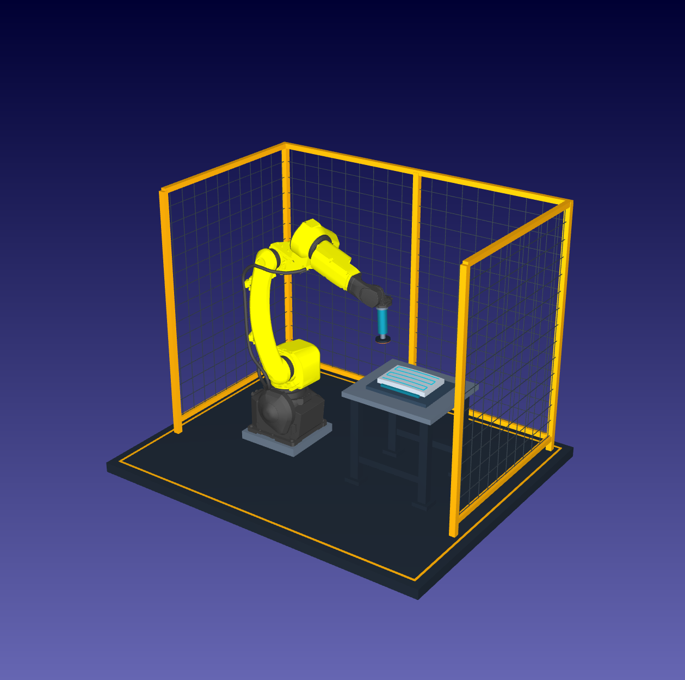
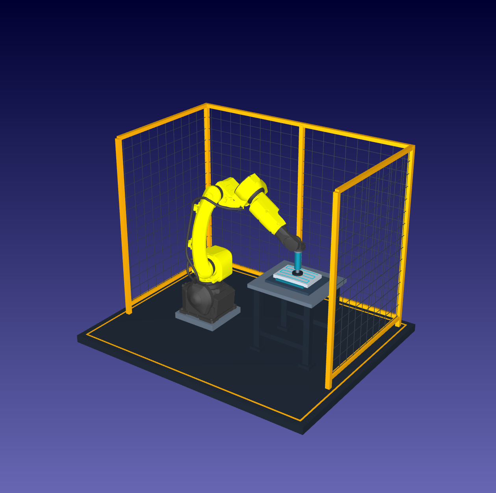
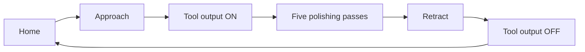

# FANUC Robotic Polishing Cell

A RoboDK portfolio project: a **FANUC M-10iD/12** follows a gently curved aluminium cover with a wrist-mounted polishing tool. The station, geometry, Python builder and motion program are included.

**5 polishing passes · 37 RoboDK instructions · 80 mm tool · Python automation**

[Português](README.pt-PT.md) · [Open the station](Celula_Polimento_FANUC.rdk) · [Engineering notes](docs/engineering.md) · [Validation record](verificacao.json)

## Showcase

<table>
  <tr>
    <td width="50%"></td>
    <td width="50%"></td>
  </tr>
  <tr>
    <td><strong>Cell layout</strong> — robot, tooling, fixture and concept guarding.</td>
    <td><strong>Working pose</strong> — tool aligned with the workpiece surface.</td>
  </tr>
</table>

Both images are actual captures of this project's RoboDK 3D view.

## What the project demonstrates

- Building a complete simulation station using the RoboDK Python API.
- Defining the robot base, workpiece frame and tool centre point (TCP).
- Generating a serpentine path whose tool orientation follows the surface normal at each programmed point.
- Combining joint moves, linear moves, speed changes and simulated digital outputs.
- Checking reachability and collisions, with explicit exclusions for intended contact.
- Keeping the program compact for the evaluation licence used during development.

## Run the station

1. Download or clone this repository.
2. Open **[`Celula_Polimento_FANUC.rdk`](Celula_Polimento_FANUC.rdk)** in RoboDK.
3. Right-click **`POLIR`** in the station tree and select **Run**.

The saved station includes its geometry and is configured to run in the simulator. Python is only needed to rebuild it. No PLC, external axis or robot connection is required.



## Cell specification

| Element | Configuration |
|---|---|
| Robot | FANUC M-10iD/12, official RoboDK library model |
| Workpiece | Representative aluminium cover, 300 × 200 × 30 mm |
| Surface | Gentle crown along X; centre is 4 mm above the ends |
| Tool | Concept polisher, Ø80 mm pad, TCP 200 mm from flange |
| Path | 5 alternating passes × 5 programmed points |
| Pass spacing | 40 mm; nominal 50% pad overlap |
| Polishing feed | 40 mm/s |
| Joint speed setting | 30 °/s for joint moves |
| Tool signal | Simulated `DO[1]` |
| Program size | 37 RoboDK instructions; 38 lines in the exported FANUC `/MN` section |
| Development environment | RoboDK 6.0.6.26902 on Omarchy Linux / XWayland |

Station item names use Portuguese. **`POLIR`** means “polish”.

## Validation and scope

The recorded RoboDK path check returned **100% valid** and **no collisions detected** for the configured collision map, sampled at **5 mm / 3°**. A complete simulator run also finished, with zero collisions at the final pose. Intended tool–workpiece and flange–tool contact are excluded from collision checks.

This demonstrates geometry, kinematics and motion sequencing. Contact force, pad deformation, material removal and finish quality are not modelled. The fixture and three-sided guard are concepts, not a validated production installation.

The full record is in [`verificacao.json`](verificacao.json). It also records the difference between the API's time estimate and the observed simulator runtime; neither is presented as a validated manufacturing cycle time.

### FANUC program sample

[`export/POLIR.LS`](export/POLIR.LS) contains the generated FANUC text program, including its `/END` marker. RoboDK's export API returned an unsuccessful status without a message even though it wrote the file. The sample is included for inspection; it has not been compiled to `.TP` or validated on a controller. UFRAME[1] and UTOOL[1] are selected, with their expected values recorded in comments.

## Rebuild from Python

Open RoboDK with its local API enabled on port **20500**, then run from the repository directory:

```bash
python -m venv .venv
source .venv/bin/activate
python -m pip install -r requirements.txt
python construir_celula.py
```

On Windows, activate the environment with `.venv\Scripts\activate` instead. The script uses the bundled API automatically when it is present at `~/.local/share/robodk/Python`; otherwise it imports the installed `robodk` package. The supplied model is in `assets/`.

Each run creates a **new station** in RoboDK and updates the generated `.rdk`, workpiece STL, overview image and validation JSON in this directory. The script performs the path check; the working-pose image, completed-run evidence and `.LS` export were captured separately for the published version. Back up those files before regenerating them if you want to retain that evidence.

## Repository contents

| File | Purpose |
|---|---|
| [`Celula_Polimento_FANUC.rdk`](Celula_Polimento_FANUC.rdk) | Complete station, ready to open |
| [`construir_celula.py`](construir_celula.py) | Geometry, frames, targets and program builder |
| [`assets/tampa_aluminio.stl`](assets/tampa_aluminio.stl) | Generated workpiece mesh, in millimetres |
| [`assets/Fanuc-M-10iD-12.robot`](assets/Fanuc-M-10iD-12.robot) | Robot model from the RoboDK library |
| [`export/POLIR.LS`](export/POLIR.LS) | FANUC text program sample |
| [`verificacao.json`](verificacao.json) | Recorded validation and export results |
| [`docs/engineering.md`](docs/engineering.md) | Coordinate frames, path design and verification details |
| [`README.pt-PT.md`](README.pt-PT.md) | Portuguese guide and CV description |

## Credits

The FANUC robot model comes from the [official RoboDK library](https://robodk.com/robot/Fanuc/M-10iD-12). The workpiece, tool concept, fixture, layout and path were created for this project. See [third-party notices](THIRD_PARTY_NOTICES.md).

**Portfolio summary:** Designed and simulated a FANUC robotic polishing cell in RoboDK, including Python-generated geometry, TCP and workpiece frames, surface-following motion and collision checking.
