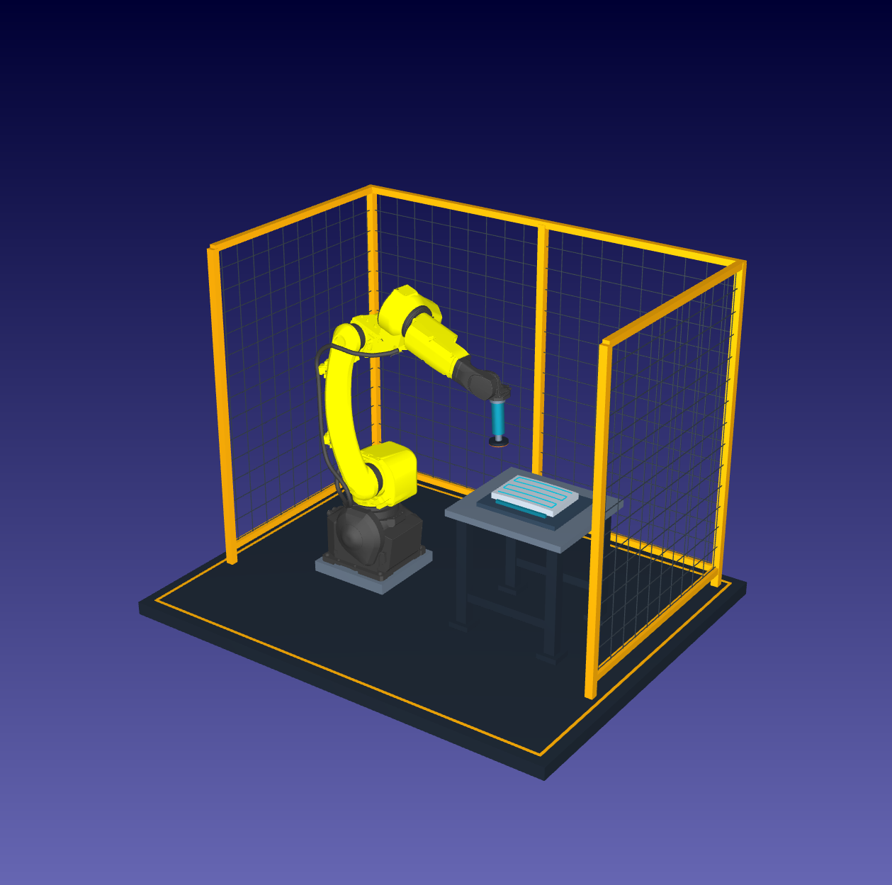

# Célula de polimento — FANUC M-10iD/12

[English overview](README.md) · [Notas de engenharia (EN)](docs/engineering.md)



Projeto de portefólio em RoboDK: um robô FANUC percorre uma tampa de alumínio
ligeiramente curva com uma polidora montada no punho.

## Abrir e executar

1. Abrir `Celula_Polimento_FANUC.rdk` no RoboDK.
2. Na árvore da estação, clicar com o botão direito em **POLIR** e selecionar
   **Run / Executar**. O programa está configurado para simulação.
3. O robô aproxima-se da peça, ativa a saída simulada da polidora, executa cinco
   passagens, afasta-se, desativa a saída e regressa à posição inicial.

O programa contém **37 instruções**, abaixo do limite de 50 da licença de avaliação.
Não são necessários PLC, eixos externos ou complementos adicionais.

## Configuração

| Elemento | Definição |
|---|---|
| Robô | FANUC M-10iD/12, modelo da biblioteca oficial RoboDK |
| Peça | Tampa representativa de alumínio, 300 × 200 × 30 mm |
| Superfície | Curvatura suave: centro 4 mm acima das extremidades |
| Polidora | Geometria conceptual, disco de 80 mm, TCP a 200 mm da flange |
| Percurso | Cinco passagens alternadas, cinco pontos por passagem |
| Espaçamento | 40 mm entre passagens; sobreposição nominal de 50% |
| Velocidade de trabalho | 40 mm/s, escolhida para a demonstração |
| Movimentos articulares de aproximação | Limite programado de 30 °/s |
| Controlo da ferramenta | DO[1] simulada: ligada antes do contacto, desligada após afastamento |
| Estrutura | Mesa, apoio da peça, base do robô e proteção conceptual em três lados |

Os pontos centrais do disco percorrem X = −130…130 mm e Y = −80…80 mm no
referencial da peça. A orientação acompanha a normal da superfície nos pontos
programados; os segmentos intermédios são movimentos lineares aproximados.

## Ficheiros

- `Celula_Polimento_FANUC.rdk`: estação completa, com geometria incorporada.
- `vista_celula.png`: imagem da célula para apresentação.
- `vista_polimento.png`: vista com a ferramenta em posição de trabalho.
- `export/POLIR.LS`: programa FANUC em texto, com 38 linhas na secção `/MN`.
- `construir_celula.py`: script reproduzível que cria uma nova estação.
- `verificacao.json`: resultados da verificação de trajetória no RoboDK.
- `assets/tampa_aluminio.stl`: geometria da peça, em milímetros.
- `assets/Fanuc-M-10iD-12.robot`: modelo do robô, descarregado de
  [RoboDK](https://robodk.com/robot/Fanuc/M-10iD-12).

Para reconstruir, abrir o RoboDK e executar no terminal, a partir da pasta do projeto.
É necessária a API Python `robodk`; consultar a instalação no [README em inglês](README.md#rebuild-from-python).

```bash
python construir_celula.py
```

## Alcance da demonstração

As imagens são capturas reais da vista 3D do RoboDK.

O projeto demonstra montagem de uma estação, referenciais, definição de TCP,
programação MoveJ/MoveL, saídas digitais simuladas e verificação de trajetória.
A trajetória foi validada a 100% e o ciclo completo terminou no simulador sem
colisões assinaladas, em aproximadamente 54 segundos a velocidade 1× neste
computador. A estimativa automática de tempo devolvida pela API difere desse
tempo observado e não foi adotada como tempo de processo validado.
A verificação de colisões usa passos de 5 mm e 3°. Os contactos intencionais entre
ferramenta e peça, e entre flange e ferramenta, são excluídos.

A força de contacto, deformação do disco, remoção de material e qualidade do
acabamento não são simuladas. A fixação e a proteção são conceptuais. Este é um
projeto de simulação para portefólio, sem validação numa instalação física.

O ficheiro FANUC `.LS` foi escrito completo, incluindo `/END`. A chamada de
exportação devolveu um estado de insucesso sem mensagem, apesar de criar o ficheiro;
por isso, este é incluído para consulta. Não foi compilado para `.TP` nem validado
num controlador. O código seleciona UFRAME[1] e UTOOL[1] e regista os valores em
comentários; não configura esses referenciais no controlador.

## Descrição curta para o CV

> Desenvolvimento de uma célula de polimento robotizado em RoboDK com FANUC
> M-10iD/12, incluindo modelação da estação, definição de TCP e referenciais,
> programação de trajetórias e verificação de movimentos em simulação.
